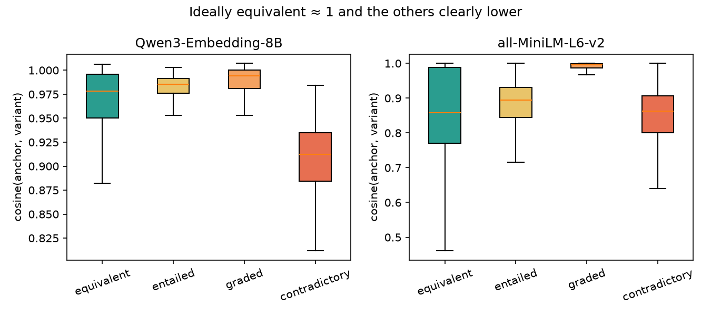
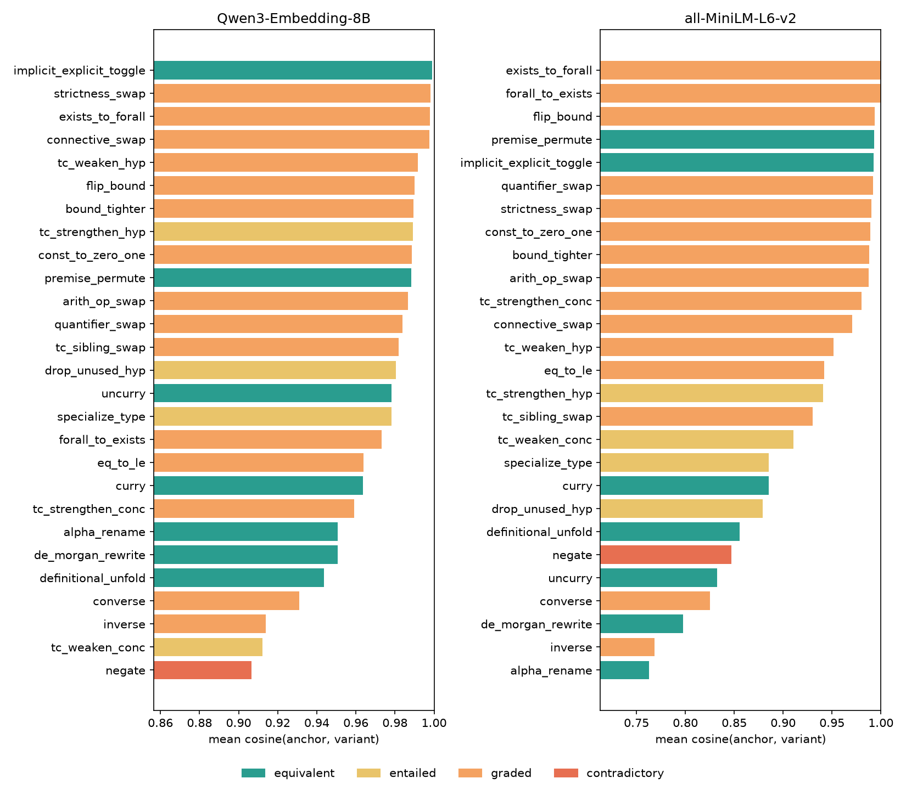
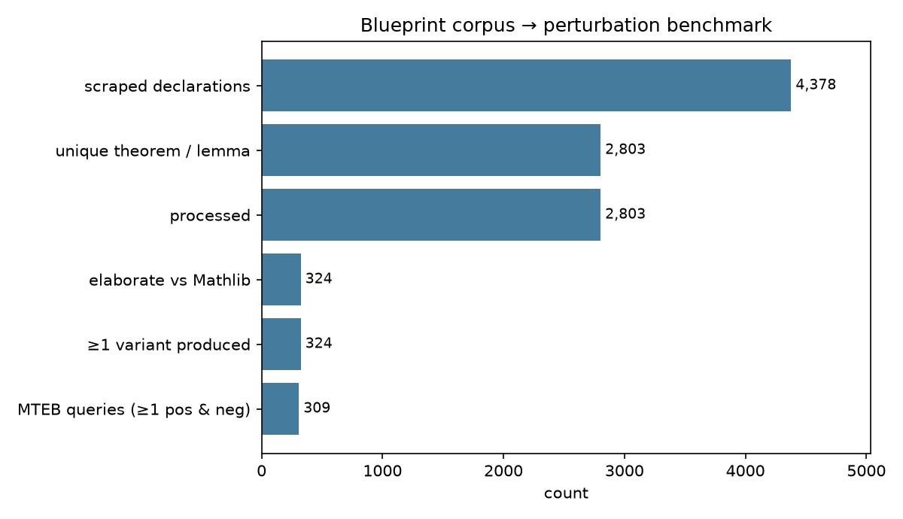
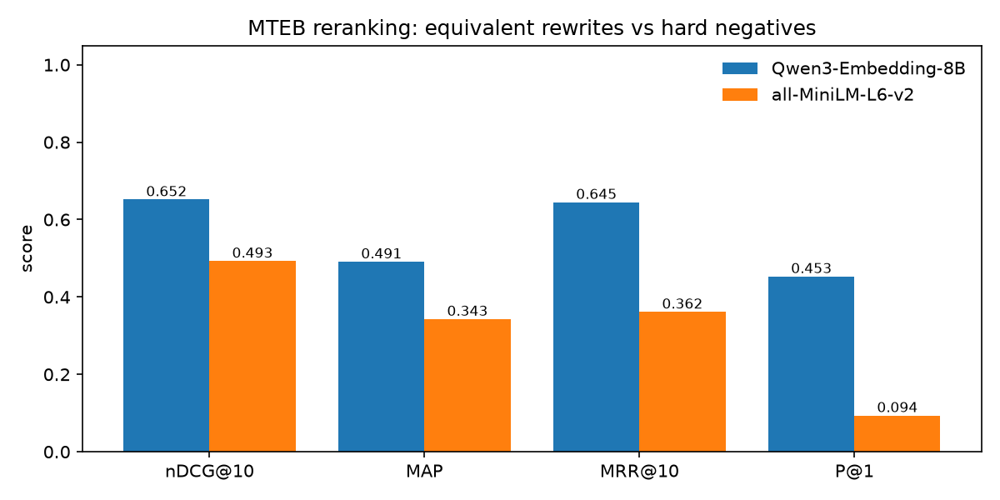
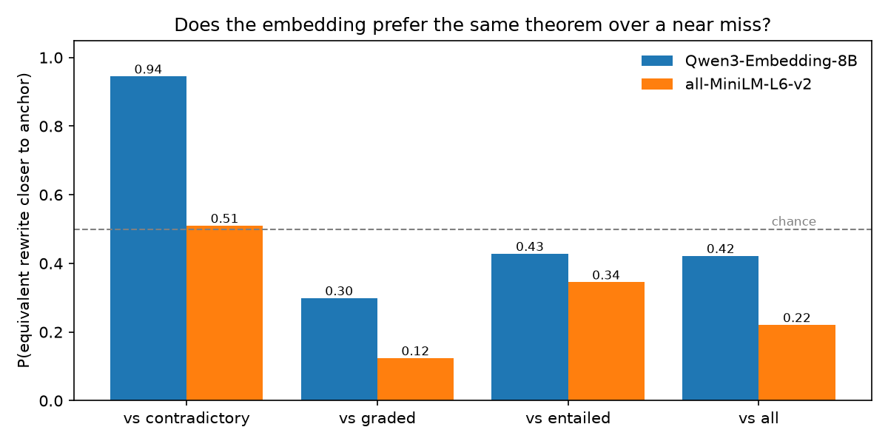
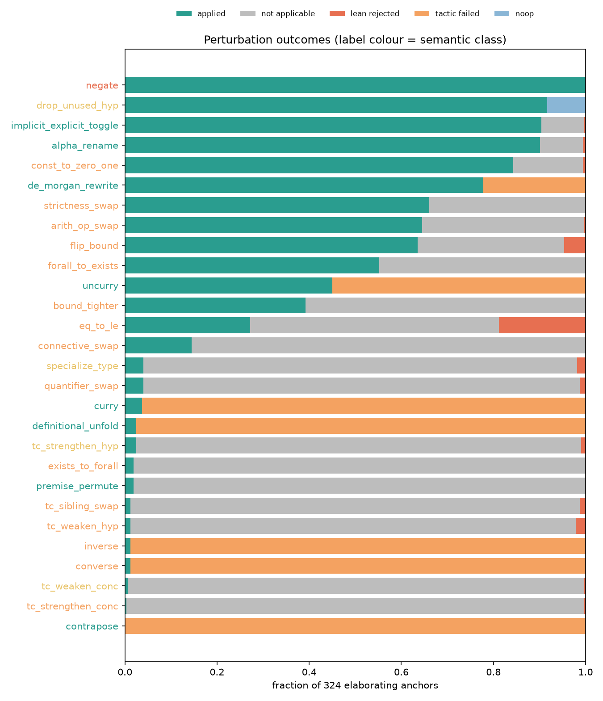

# Perturbation embedding eval

## Data

| stage | count |
|---|---|
| scraped declarations | 4,378 |
| unique theorem / lemma | 2,803 |
| processed | 2,803 |
| elaborate vs Mathlib | 324 |
| ≥1 variant produced | 324 |
| MTEB queries (≥1 pos & neg) | 309 |

MTEB task: 309 queries, 993 equivalent rewrites, 1,925 hard negatives.

## Scores

| model | nDCG@10 | MAP | MRR@10 | P@1 | equiv > negative |
|---|---|---|---|---|---|
| Qwen/Qwen3-Embedding-8B | 0.6520 | 0.4912 | 0.6449 | 0.4531 | 0.4217 |
| sentence-transformers/all-MiniLM-L6-v2 | 0.4931 | 0.3430 | 0.3615 | 0.0939 | 0.2205 |

## Figures

