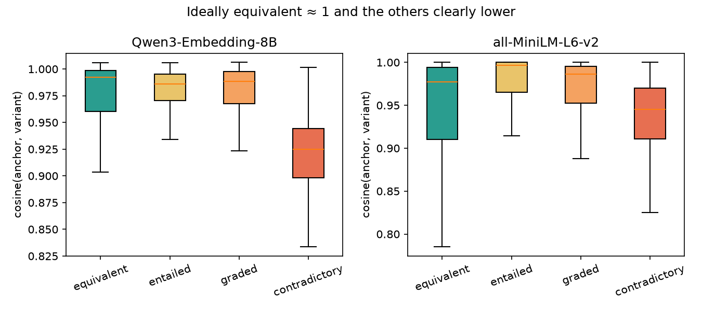
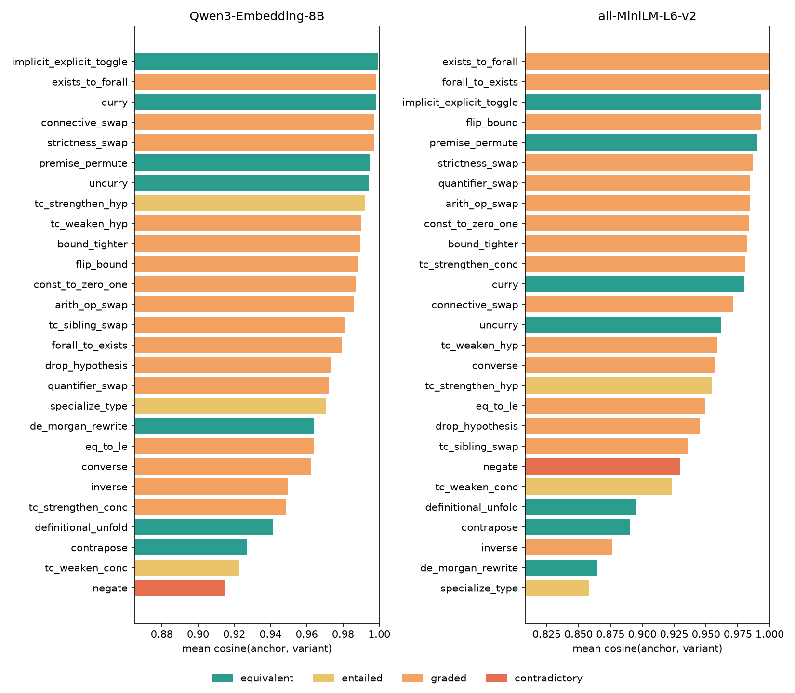
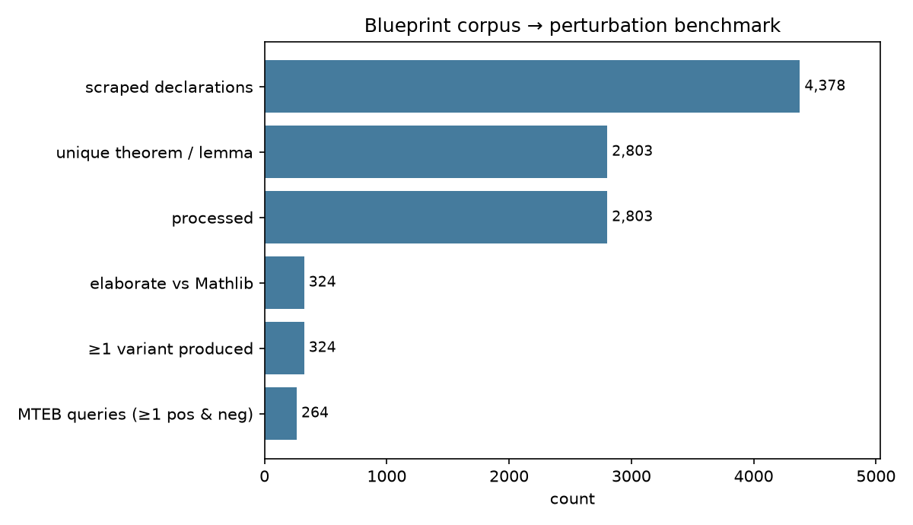
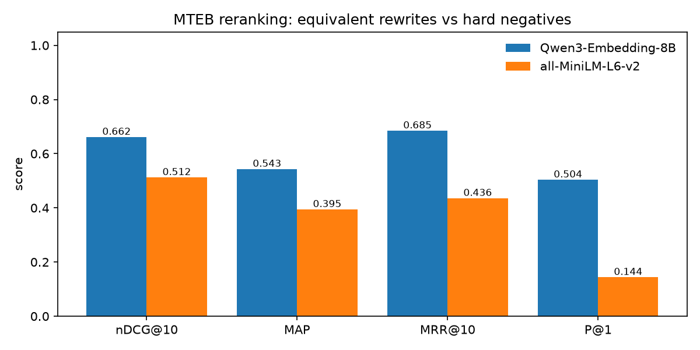
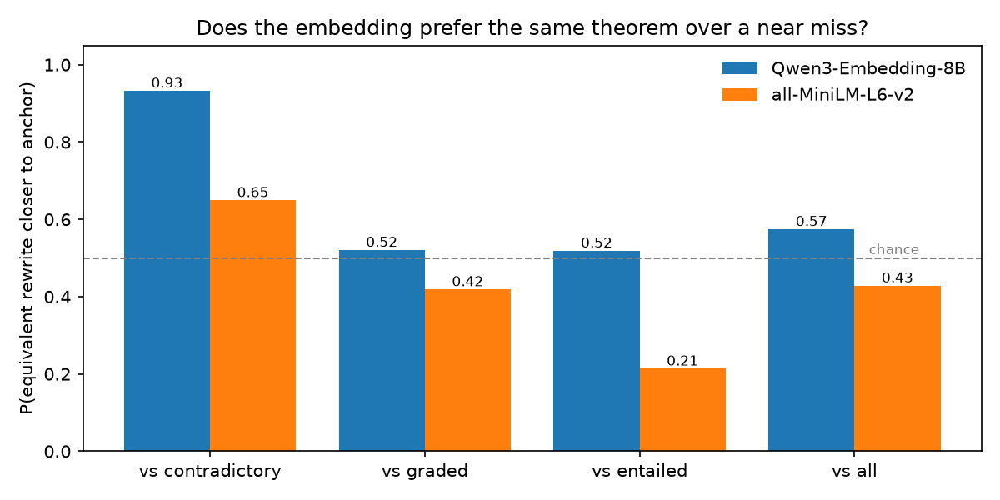
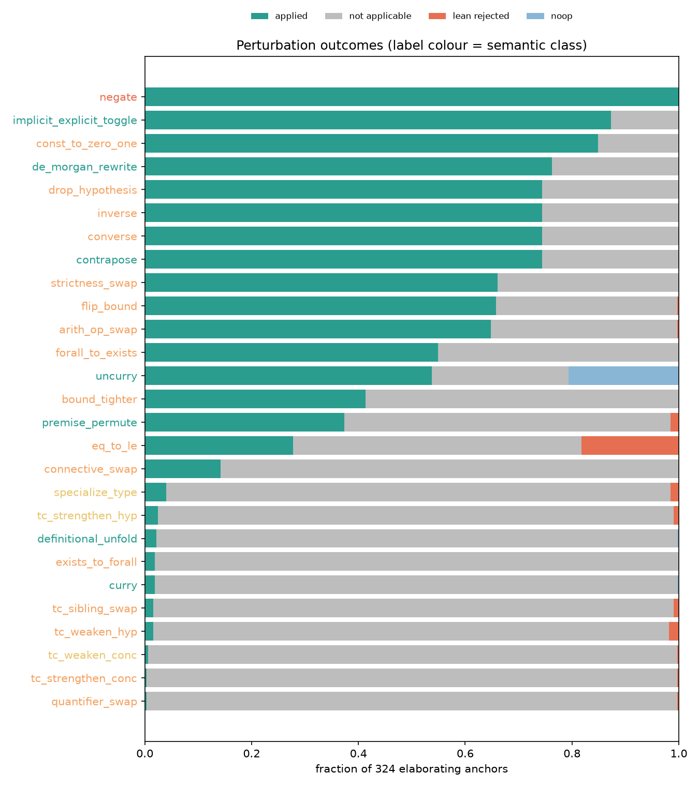

# Perturbation embedding eval

## Data

| stage | count |
|---|---|
| scraped declarations | 4,378 |
| unique theorem / lemma | 2,803 |
| processed | 2,803 |
| elaborate vs Mathlib | 324 |
| ≥1 variant produced | 324 |
| MTEB queries (≥1 pos & neg) | 264 |

MTEB task: 264 queries, 863 equivalent rewrites, 2,014 hard negatives.

## Scores

| model | nDCG@10 | MAP | MRR@10 | P@1 | equiv > negative |
|---|---|---|---|---|---|
| Qwen/Qwen3-Embedding-8B | 0.6615 | 0.5434 | 0.6850 | 0.5038 | 0.5742 |
| sentence-transformers/all-MiniLM-L6-v2 | 0.5125 | 0.3945 | 0.4358 | 0.1439 | 0.4282 |

## Figures

